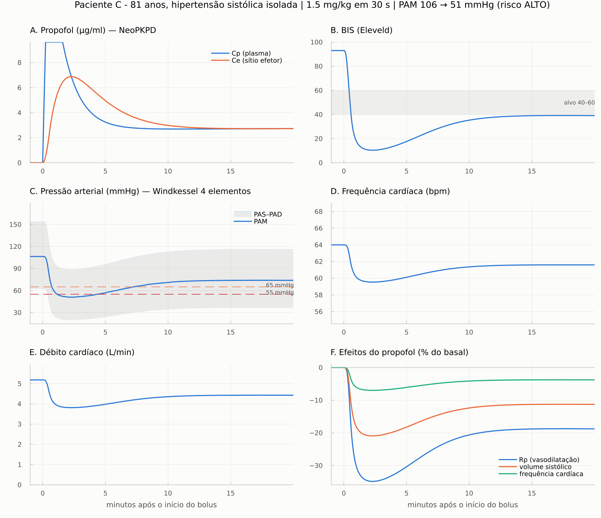

# Modelo *in silico* para predição hemodinâmica da indução anestésica com propofol

**PBL 6 — Modelagem e Simulação de Sistemas Biomédicos**

> **Pergunta:** *Como prever, por simulação, a resposta hemodinâmica de um paciente ao propofol?*

**Proposta:** um **paciente virtual** montado com os dados pré-indução do próprio paciente, em
que a PK/PD do propofol (**NeoPKPD**: Schnider/Marsh + BIS de Eleveld) move os parâmetros de um
**Windkessel de 4 elementos** (**windkessel-id**, Stergiopulos 1999). O modelo prevê a curva de
PAM para a dose escolhida **antes da injeção**.

O núcleo do modelo segue o repositório do grupo,
**[PropofolPBL](https://github.com/gabiadamek30-bit/Simula-o-da-resposta-do-paciente-ao-propofol---PBL)**:
mesmas equações, mesmos valores padrão e os mesmos testes. Sobre ele, este repositório
acrescenta calibração com PAS/PAD, métricas de hipotensão, janela de dose, faixa de incerteza,
coorte virtual e uma plataforma web para médicos.


## O problema

- O propofol causa **vasodilatação periférica**, **depressão do miocárdio** e **atenuação do
  barorreflexo** → hipotensão.
- **Hipotensão pós-indução** = queda de pressão nos primeiros 20 min; **17–24% dos adultos** ficam
  com **PAM < 55 mmHg**, e PAM ≤ 55 mmHg sustentada associa-se a lesão miocárdica e renal aguda.
- A dose segue uma faixa por peso ajustada por idade, sexo, estado de saúde e medicações, mas a
  resposta varia: **a dose certa só se confirma depois da injeção.**

## Como o modelo funciona

```
Paciente ──► PK (Schnider/Marsh, NeoPKPD) ──► Cp(t) ──► ke0 ──► Ce(t) ──► BIS (Eleveld)
                                                                  │
  PAM, FC, DC basais ──► θ = [Rp, C, Rc, L] ◄─────────────────────┘ Emax sigmoide × sensibilidade
  PAS − PAD ──► C do paciente virtual  │                             (idade, ASA, PVI, IVCI)
                                        ▼
          fluxo aórtico (Stergiopulos) ─► Windkessel de 4 elementos ─► pressão arterial batimento a batimento
```

| bloco | modelo | origem |
|---|---|---|
| farmacocinética | tricompartimental (Schnider ou Marsh) com bolus + manutenção e compartimento de efeito | [NeoPKPD](https://github.com/shramish2057/NeoPKPD), como no grupo |
| hipnose | BIS de Eleveld (2018), Ce50 dependente da idade | grupo |
| circulação | Windkessel de 4 elementos [Rp, C, Rc, L], alimentado pelo fluxo aórtico de Stergiopulos (1999) escalado por VS e FC | [windkessel-id](https://github.com/hpigot/windkessel-id), porta do grupo |
| efeito do propofol | Emax sigmoide sobre Rp (Imax 0,25), VS (0,15) e FC (0,05), Ce50 = 3 µg/ml, γ = 2, × sensibilidade *s* | grupo (valores ilustrativos) |
| sensibilidade | *s* = 1 + 0,01(idade−50)⁺ + 0,15(ASA−2)⁺ + 0,03(PVI−13)⁺ + 0,01(IVCI−40)⁺ | grupo |
| paciente virtual | Rp = PAM/DC; **C identificado** para reproduzir a pressão de pulso medida | extensão |

Equações completas: **[docs/modelo_matematico.md](docs/modelo_matematico.md)** ·
Repositórios e literatura: **[docs/revisao_github_literatura.md](docs/revisao_github_literatura.md)** ·
Credibilidade (ASME V&V 40): **[docs/validacao.md](docs/validacao.md)**

## Instalação e uso

Requer Julia ≥ 1.10 (instalador oficial **juliaup**:
Windows `winget install --name Julia --id 9NJNWW8PVKMN -e -s msstore`;
Linux/macOS `curl -fsSL https://install.julialang.org | sh`).

**Plataforma para médicos (navegador)** — no Julia:

```julia
using Pkg
Pkg.add(url="https://github.com/vivianguilger-lab/PBL_6", rev="claude/windkessel-propofol-hemodynamic-p72qsk")
using PropofolWindkessel
plataforma()          # abre http://localhost:8080
```

A primeira instalação demora (o NeoPKPD traz o DifferentialEquations). Quem já tinha instalado:
`using Pkg; Pkg.update()`. Com a pasta do projeto no Windows: duplo clique em
`abrir_plataforma.bat`. Os dados não saem do computador (o servidor só aceita conexões locais).

**No REPL:**

```julia
using PropofolWindkessel
p  = Paciente(idade = 62, sexo = :F, peso = 72, altura = 160, pas = 148, pad = 82, fc = 78,
              asa = 2, pvi = 12, ivci = 25)
pv = calibrar(p)                                    # paciente virtual
r  = simular_inducao(pv; dose_mgkg = 1.5)           # bolus em 30 s + 100 µg/kg/min
relatorio(metricas(r))
previsao_com_incerteza(pv; dose_mgkg = 1.5)         # faixa 90% e P(PAM < 65), P(PAM < 55)

# interface do grupo, inalterada:
pkpd, batimentos, onda = simular_paciente(p; tfim = 30.0, forma_de_onda = true)
```

**Scripts** (`julia --project=. -t auto scripts/<script>`; `rodar_tudo.jl` regenera `resultados/`):

| script | o que faz |
|---|---|
| `01_verificacao.jl` | Windkessel e NeoPKPD contra soluções exatas |
| `02_prever_paciente.jl dados/paciente_exemplo.toml` | paciente virtual, previsão, incerteza, ondas de pressão e fluxo |
| `03_janela_de_dose.jl dados/paciente_idoso.toml` | varredura de doses, janela individual, velocidade de injeção |
| `04_coorte_virtual.jl 500` | ensaio clínico virtual com 500 adultos |
| `05_sensibilidade.jl dados/paciente_exemplo.toml` | sensibilidade local (±10%) dos parâmetros do grupo |
| `06_identificacao_windkessel.jl` | identificação do Windkessel 2/3/4 elementos (Stergiopulos e in vivo) |

Testes: `julia --project=. -e "using Pkg; Pkg.test()"` (47 testes, inclusive os do grupo).

## Resultados (com os parâmetros ilustrativos do grupo)

**Verificação** — Windkessel de 2 elementos × `P₀·e^{−t/RpC}`: erro 5 × 10⁻¹⁴; NeoPKPD ×
`exp(K·t)·A₀`: 8 × 10⁻¹⁰; Windkessel de 4 elementos: PAM = Rp·Q̄ com erro 8 × 10⁻¹⁶.
A identificação recupera θ de Stergiopulos (Rp 0,80; C 1,25; Rc 0,056; L 0,0055 contra
0,79; 1,22; 0,056; 0,0051 publicados; RMSE 2,4 mmHg).


**Três pacientes** (bolus em 30 s + manutenção de 100 µg/kg/min):

| paciente | dose | PAM basal → mínima | P(PAM<65) | P(PAM<55) | janela de dose |
|---|---|---|---|---|---|
| A — 62 a, ♀, ASA II, PVI 12% | 1,5 mg/kg | 104 → 66 mmHg (2,0 min) | 40% | 10% | 0,50–1,63 mg/kg |
| B — 28 a, ♂, ASA I | 2,0 mg/kg | 89 → 57 mmHg (1,8 min) | 94% | 34% | — |
| C — 81 a, ♂, ASA III, PVI 18%, IVCI 45% (s = 1,66) | 1,5 mg/kg | 106 → 51 mmHg (2,3 min) | 92% | 64% | 0,50–0,75 mg/kg |



**Coorte virtual (500 adultos):** com a dose ajustada por idade, **PAM < 55 em 35%** e PAM < 65
em 75% — acima dos 17–24% da literatura. O risco cresce com ASA (29% no ASA I → 50% no ASA III)
e com a idade. **Multiplicar os três Imax do grupo por ≈ 0,85 traria a coorte para ≈ 20%**:
é a sugestão de calibração populacional para o grupo discutir (os valores padrão foram mantidos).


**Sensibilidade:** o que mais muda a PAM mínima é o fator de sensibilidade *s*, o Imax da
vasodilatação, o Ce50 hemodinâmico e a dose. A complacência C quase não influi na PAM (PAM = Rp·Q̄).

## Limitações

- Os parâmetros do efeito hemodinâmico e da sensibilidade são **ilustrativos** (como diz o
  grupo) e superestimam a hipotensão na coorte; precisam ser calibrados com dados reais
  (ex.: banco aberto VitalDB). **Ainda não há validação com dados de pacientes.**
- Modelo aberto: o fluxo aórtico é imposto; não há barorreflexo nem retorno venoso explícitos.
- Um único ke0 para BIS e pressão (o efeito na pressão na prática é mais lento — Kazama 1999).
- PAM e pressão de pulso são reproduzidas exatamente; PAS e PAD individualmente, não (a forma
  da onda de Stergiopulos é fixa).
- SpO₂ e glicemia ainda não entram em nenhuma equação; sem opioides, laringoscopia, fluidos ou vasopressores.

## Estrutura

```
src/
  PropofolWindkessel.jl  módulo
  windkessel.jl          porta do windkessel-id (grupo): G2/G3/G, solvex0, identify
  dados.jl               dados de Stergiopulos e in vivo (dados/windkessel-id/)
  paciente.jl            biomarcadores (ASA, PVI, IVCI, SpO₂, glicemia…)
  propofol.jl            PK Schnider/Marsh + BIS de Eleveld sobre o NeoPKPD
  acoplamento.jl         Ce → Rp, VS, FC → Windkessel → PA batimento a batimento (grupo)
  calibracao.jl          paciente virtual e simulação da indução
  metricas.jl, dose.jl, incerteza.jl, populacao.jl, plataforma.jl
app/index.html           interface da plataforma
scripts/                 análises 01–06 e figuras
dados/                   pacientes de exemplo (TOML) e dados do windkessel-id
resultados/              figuras, CSV e logs
docs/                    modelo, revisão do GitHub/literatura, V&V 40
test/                    testes (GitHub Actions)
```

O modelo anterior deste repositório (coração de elastância variável em malha fechada com
barorreflexo) está no histórico do git, até o commit `d3dd331`.
