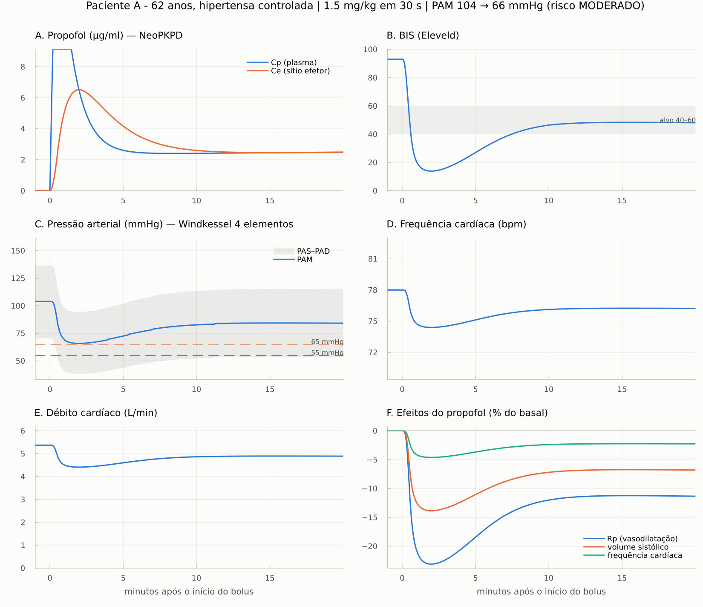
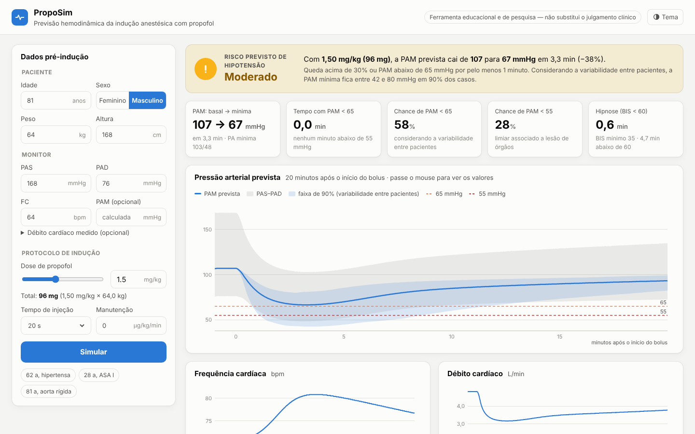
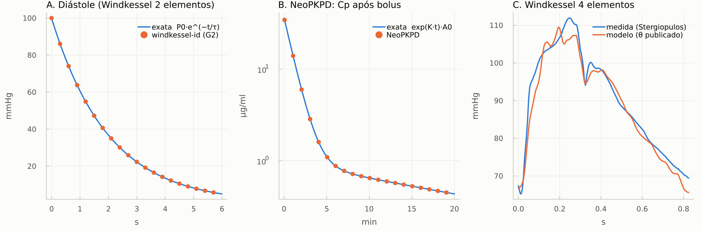
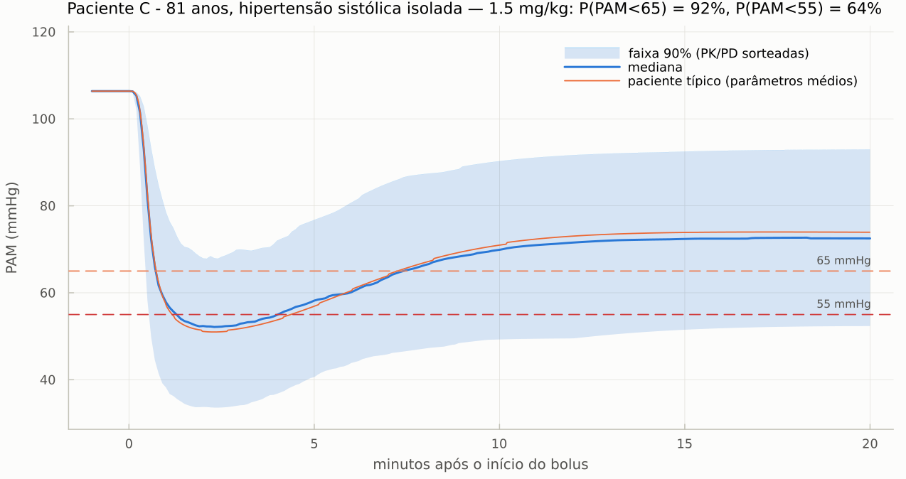
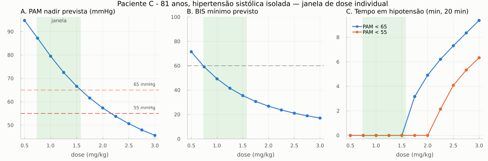
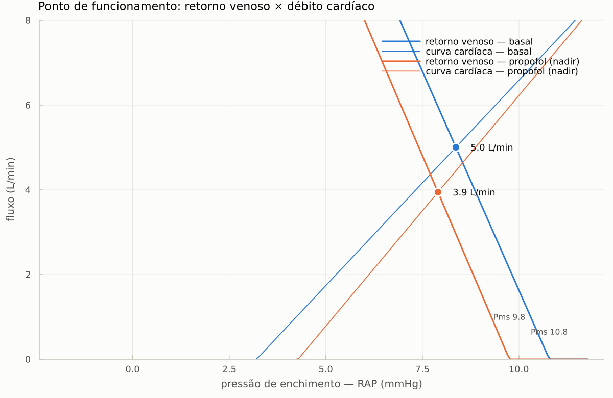
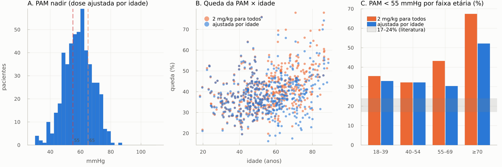
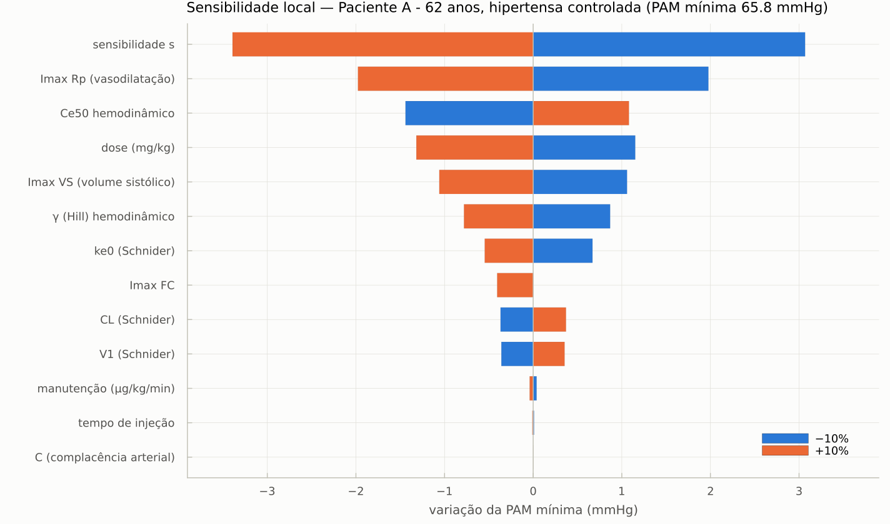

# Modelo *in silico* para predição hemodinâmica da indução anestésica com propofol

**PBL 6 — Modelagem e Simulação de Sistemas Biomédicos**

> **Pergunta:** *Como prever, por simulação, a resposta hemodinâmica de um paciente ao propofol?*

**Proposta:** um **paciente virtual** calibrado com os dados pré-indução do próprio paciente,
em que a farmacocinética de **Schnider** e curvas de **Hill** (PK/PD) movem os parâmetros de um
modelo **Windkessel em malha fechada** (coração de elastância variável + árvore arterial + veias +
barorreflexo). O modelo prevê a curva de PAM para a dose escolhida **antes da injeção**.



## O problema

- O propofol causa **vasodilatação periférica** (↓ resistência vascular), **depressão do
  miocárdio** e **atenuação do barorreflexo** → hipotensão.
- **Hipotensão pós-indução** = queda de pressão nos primeiros 20 min; **17–24% dos adultos** ficam
  com **PAM < 55 mmHg**, e PAM ≤ 55 mmHg sustentada associa-se a lesão miocárdica e renal aguda.
- A dose segue uma faixa por peso ajustada por idade, sexo, estado de saúde e medicações, mas a
  resposta varia entre pacientes: **a dose certa só se confirma depois da injeção.**

## Como o modelo funciona

```
dados pré-indução ──► calibração ──► paciente virtual (Windkessel + coração + veias + barorreflexo)
(idade, sexo, peso,       (TPR, AC, V0 venoso)                     ▲
 altura, PAS, PAD, FC)                                             │ TPR ↓  Emax ↓  V0v ↑  ganho ↓
                                                                   │
dose escolhida ──► PK Schnider ──► Ce cérebro / Ce vascular ──► curvas de Hill
                                                                   │
                                     curva de PAM prevista, nadir, tempo < 65/55 mmHg, BIS
```

| bloco | modelo | de onde vêm os números |
|---|---|---|
| farmacocinética | 3 compartimentos de **Schnider** + 2 compartimentos de efeito (cérebro e vasos) | Schnider 1998/1999; Kazama 1999 (efeito na PA mais lento e mais lento no idoso) |
| farmacodinâmica | **Hill** para BIS, TPR, contratilidade, tônus venoso e ganho do barorreflexo | Bouillon 2004; **Su et al. 2023**; de Wit 2016 (qualitativo) |
| circulação | **Windkessel de 3 elementos** + ventrículo como **capacitor variável** (C_D ↔ C_S) + veias com volume não estressado, em malha fechada | equações do Resumo da disciplina (Seções 12–16) |
| controle | **barorreflexo** (malha fechada sobre FC, TPR, contratilidade e tônus venoso) | inspirado em Ursino 1998 |
| paciente virtual | ajuste de TPR, AC e V0 venoso a PAM, pressão de pulso e DC do paciente | abordagem *grey-box* |

Equações completas e tabela de parâmetros com as fontes: **[docs/modelo_matematico.md](docs/modelo_matematico.md)**.
Repositórios do GitHub pesquisados e literatura: **[docs/revisao_github_literatura.md](docs/revisao_github_literatura.md)**.
Credibilidade (ASME V&V 40): **[docs/validacao.md](docs/validacao.md)**.

## Instalação

1. Instale o Julia (≥ 1.10), de preferência pelo **juliaup** (instalador oficial):
   - Windows: `winget install --name Julia --id 9NJNWW8PVKMN -e -s msstore`
   - Linux/macOS: `curl -fsSL https://install.julialang.org | sh`
2. Na pasta do projeto, instale as dependências (só na primeira vez; leva alguns minutos):
   ```
   julia --project=. -e "using Pkg; Pkg.instantiate()"
   ```
3. Rode os testes de verificação:
   ```
   julia --project=. -e "using Pkg; Pkg.test()"
   ```

## Plataforma para médicos (navegador)



Interface web que roda no próprio computador: o médico digita os dados do monitor e a dose,
e vê o risco previsto, a curva de pressão com a faixa de incerteza, FC, DC, BIS, concentrações,
a comparação de doses (com a faixa sugerida) e o porquê da queda (vasodilatação, depressão
miocárdica, venodilatação). Botões para imprimir/salvar PDF e baixar a curva em CSV. Os dados
não saem do computador (o servidor só aceita conexões locais).

No Julia (instalação pelo GitHub, sem baixar pasta):

```julia
using Pkg
Pkg.add(url="https://github.com/vivianguilger-lab/PBL_6", rev="claude/windkessel-propofol-hemodynamic-p72qsk")
using PropofolWindkessel
plataforma()          # abre http://localhost:8080 no navegador
```

Com a pasta do projeto no Windows: duplo clique em `abrir_plataforma.bat`.

## Uso

**Windows, sem terminal:** extraia o ZIP (botão direito → *Extrair tudo*) e dê **duplo clique em
`rodar_previsao.bat`**. Para outro paciente, arraste o arquivo `.toml` da pasta `dados` para cima
do `rodar_previsao.bat`. As figuras ficam na pasta `resultados`.

**Prever um paciente:** edite (ou copie) `dados/paciente_exemplo.toml` com os dados pré-indução
e a dose pretendida, e rode

```
julia --project=. -t auto scripts/02_prever_paciente.jl dados/paciente_exemplo.toml
```

**No REPL do Julia:**

```julia
using PropofolWindkessel
p  = Paciente(idade = 62, sexo = :F, peso = 72, altura = 160, pas = 148, pad = 82, fc = 78)
pv = calibrar(p)                                   # paciente virtual
r  = simular_inducao(pv; dose_mgkg = 1.5)          # previsão antes da injeção
relatorio(metricas(r))
janela_de_dose(pv; limiar_pam = 65)                # dose mínima hipnótica × dose máxima "segura"
previsao_com_incerteza(pv; dose_mgkg = 1.5)        # faixa 90% e P(PAM < 65), P(PAM < 55)
```

| script | o que faz |
|---|---|
| `scripts/01_verificacao.jl` | compara o código com soluções exatas (Windkessel, PK, Pms) |
| `scripts/02_prever_paciente.jl` | calibra o paciente, prevê a curva de PAM, faixa de incerteza, ondas, laço P–V e diagrama de Guyton |
| `scripts/03_janela_de_dose.jl` | varre doses, calcula a janela individual e compara velocidades de injeção |
| `scripts/04_coorte_virtual.jl` | ensaio clínico virtual com 500 adultos e três protocolos de dose |
| `scripts/05_sensibilidade.jl` | análise de sensibilidade local (±10%) |
| `scripts/rodar_tudo.jl` | roda tudo e regenera `resultados/` |

## Resultados

### 1. Verificação ("resolvi as equações corretamente?")

| problema com solução exata | erro numérico |
|---|---|
| Windkessel de 2 elementos na diástole, `P₀·e^{−t/τ}` com τ = TPR·AC | 3 × 10⁻⁸ |
| PK de Schnider, `exp(K·t)·A₀` | 3 × 10⁻¹³ |
| parada cardíaca → todas as pressões = `Pms = (Vt − V0)/Ct` | 4 × 10⁻⁷ mmHg |
| conservação do volume de sangue | 8 × 10⁻¹² ml |
| mesmo circuito montado com `CirculatorySystemModels.jl` (verificação cruzada, `extras/`) | 10⁻⁴ mmHg |



### 2. Três pacientes, três previsões

| paciente | dados pré-indução | dose | PAM basal → nadir | queda | P(PAM<65) | P(PAM<55) | risco |
|---|---|---|---|---|---|---|---|
| A — 62 a, ♀, hipertensa controlada | 148/82, FC 78 | 1,5 mg/kg | 104 → 80 mmHg (2,7 min) | 23% | 18% | 7% | baixo |
| B — 28 a, ♂, ASA I | 124/72, FC 74 | 2,0 mg/kg | 89 → 57 mmHg (2,5 min) | 37% | 84% | 52% | moderado |
| C — 81 a, ♂, hipertensão sistólica isolada | 168/76, FC 64 | 1,5 mg/kg | 107 → 67 mmHg (3,3 min) | 38% | 52% | 27% | moderado |

O paciente virtual C (aorta rígida: AC = 0,78 ml/mmHg, τ = 0,9 s, contra 2,0 ml/mmHg e
1,6 s num adulto de 53 anos) mostra a "assinatura" do envelhecimento do Resumo (Seção 12.5),
e a queda do DC (−35%) domina, pelo efeito inotrópico negativo maior no idoso.



**Janela de dose individual** (menor dose com BIS < 60 × maior dose com PAM nadir ≥ 65 mmHg):
paciente A: 0,76–2,51 mg/kg; paciente C: **0,73–1,58 mg/kg** — o modelo "desaconselharia"
2 mg/kg no idoso antes da injeção.



**Velocidade de injeção:** injetar a mesma dose em 10 s ou em 2 min quase não muda o nadir
(66,6 vs 67,0 mmHg no paciente C), porque o efeito vascular equilibra devagar (t½ ≈ 10 min).
No modelo, o que protege é **usar menos dose** (titular até a perda de consciência), não a
velocidade em si.

**Mecanismo pelo diagrama de Guyton** (Resumo, Seção 16): no paciente C, Pms cai de 10,8 para
9,8 mmHg (venodilatação desloca a curva de retorno venoso para a esquerda) e C_S sobe de 0,45
para 0,97 ml/mmHg (depressão miocárdica achata a curva cardíaca); o ponto de funcionamento
desce. Como TPR entra no retorno venoso multiplicada por AC/(AC+VC) ≈ 0,01, a vasodilatação
arteriolar derruba a PAM mas quase não mexe no retorno venoso.



### 3. Ensaio clínico virtual (500 adultos)

| protocolo | PAM < 65 | **PAM < 55** | queda mediana |
|---|---|---|---|
| 2 mg/kg para todos | 62% | 36% | 34% |
| **dose ajustada por idade** (2,0 / 1,5 / 1,2 mg/kg) | 48% | **25%** | 29% |
| ajustada + manutenção 100 µg/kg/min | 59% | 34% | 33% |
| literatura (dados do problema) | — | **17–24%** | — |

Com dose fixa, PAM < 55 vai de 27% (18–39 anos) a **63% (≥ 70 anos)**; o ajuste por idade
equaliza o risco entre as faixas — e o que sobra é **variabilidade individual**, exatamente o que
o paciente virtual individualizado tenta capturar.



### 4. Sensibilidade

Os parâmetros que mais mudam o nadir (paciente A, ±10%): **dose**, **ke0 vascular** (Kazama),
**atenuação do barorreflexo** (assumida), **C50 da TPR** (Su), **DC pré-indução** (estimado) e
**efeito inotrópico** (Su). São os primeiros a serem individualizados com dados reais.



## Limitações e próximos passos

- **Validação com dados humanos independentes ainda não foi feita** — o que existe é verificação
  numérica e plausibilidade (resposta típica e incidência populacional). Próximo passo proposto:
  banco aberto **VitalDB** (infusões de propofol + pressão arterial), separando casos de
  calibração e de validação.
- Parâmetros **assumidos**: magnitude da venodilatação e da atenuação do barorreflexo
  (calibrados para reproduzir a resposta clássica do adulto típico).
- Para o adulto jovem com 2 mg/kg o modelo prevê P(PAM<55) ≈ 50%, provavelmente **pessimista** —
  um ponto a checar na validação.
- Sem opioides de coindução, laringoscopia/intubação, fluidos ou vasopressores (entram como
  novas entradas do modelo).
- Modelo 0-D com um ventrículo: não reproduz a propagação/reflexão de ondas (a amplificação
  periférica da pressão de pulso é tratada por uma equação de observação).
- A sensibilidade individual ao fármaco é desconhecida antes da injeção → faixa de incerteza
  larga. Ideia: **dose-teste** pequena + recalibração bayesiana dos parâmetros de PD.

Lista completa em [docs/validacao.md](docs/validacao.md).

## Por que Julia (e não Python primeiro)

O ponto forte do Julia é exatamente este tipo de problema: EDOs rígidas/descontínuas
integradas com `OrdinaryDiffEq.jl` (20 min de simulação pulsátil ≈ 1 500 batimentos em menos
de 1 s), o que permite calibrar e simular **centenas de pacientes virtuais em poucos minutos**,
e o ecossistema `ModelingToolkit.jl` + **`CirculatorySystemModels.jl`** (biblioteca de
componentes Windkessel em Julia — ver `extras/`). A sintaxe é próxima de Python/Matlab;
fazer primeiro em Python só duplicaria o trabalho.

## Estrutura

```
src/                 módulo PropofolWindkessel
  paciente.jl          dados pré-indução, massa magra, volemia, superfície corporal
  farmacocinetica.jl   Schnider + compartimentos de efeito + esquema de infusão
  farmacodinamica.jl   equação de Hill e efeitos do propofol
  windkessel.jl        circulação em malha fechada + barorreflexo (as EDOs)
  simulacao.jl         integração numérica e extração batimento a batimento
  calibracao.jl        paciente virtual (grey-box)
  metricas.jl          métricas de hipotensão e relatório
  dose.jl              varredura de dose e janela terapêutica
  populacao.jl         coorte virtual (variabilidade interindividual)
  incerteza.jl         previsão individual com faixa de incerteza
  guyton.jl            ponto de funcionamento (retorno venoso × débito cardíaco)
scripts/             análises reprodutíveis (01–05) e figuras
dados/               pacientes de exemplo (TOML)
resultados/          figuras, CSV e logs gerados
docs/                modelo matemático, revisão do GitHub/literatura, V&V 40
test/                testes de verificação (rodados no GitHub Actions)
extras/              o mesmo circuito montado com CirculatorySystemModels.jl
```
